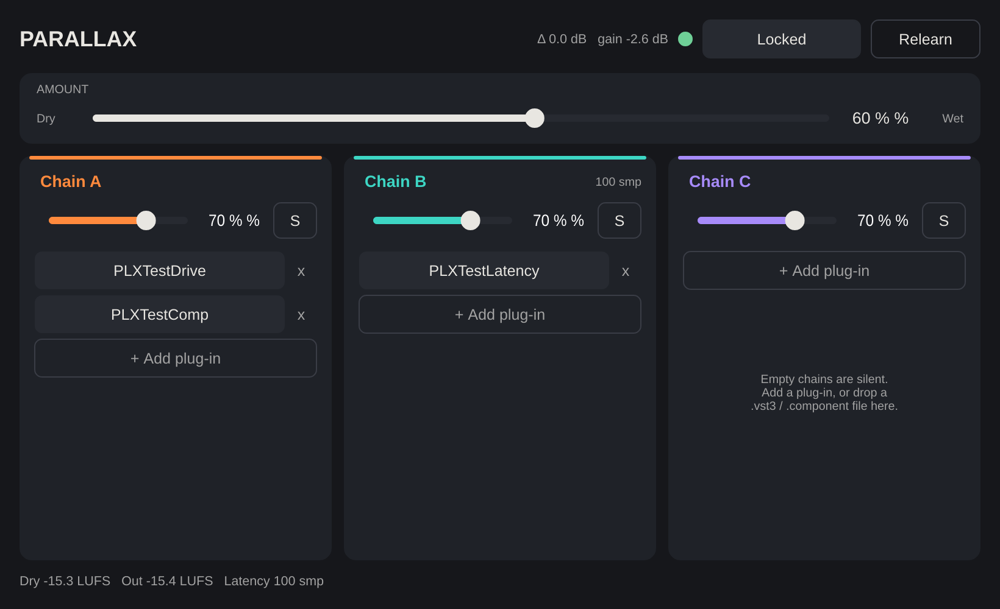

# Parallax

פלאגין VST3 לעיבוד פרלל: דריי ועוד שלושה Chains (‏A, ‏B, ‏C) של פלאגינים חיצוניים (VST3 / Audio Units), מעורבבים במקביל. ה-**Loudness Lock** שומר שעוצמת היציאה תהיה תמיד כמו הדריי, ככה ששומעים את הצבע ולא את הווליום.

## הורדה והתקנה (Mac)

1. מורידים את **Parallax-Installer.pkg** מ-[Releases](../../releases/latest).
2. פותחים אותו. אם macOS אומר שהמפתח לא מזוהה: קליק ימני על הקובץ ← **Open** ← **Open**.
3. ב-Ableton Live: ‏Settings ← Plug-Ins ← מפעילים **Use VST3 Plug-In System Folders** ולוחצים **Rescan**.
   ‏Parallax יופיע תחת Plug-Ins ← VST3 ← Parallax Audio.

## איך עובדים

- **Amount**: כמה פרלל נכנס מול הדריי (Equal-power).
- **A / B / C**: כמה מכל Chain, כל אחד בנפרד. ‏Chain ריק לא משמיע כלום.
- **+ Add plug-in**: חיפוש בכל הפלאגינים שמותקנים אצלך. לחיצה כפולה מוסיפה. אפשר גם לגרור קובץ ‎`.vst3` או ‎`.component` מה-Finder לתוך Chain.
- **לחיצה על שם פלאגין**: פותחת או סוגרת את החלון שלו. קליק ימני: הזזה למעלה או למטה, והסרה. ‏**x**: הסרה.
- **S**: סולו ל-Chain, באותה עוצמה כמו הדריי.
- **Lock**: אחרי כל שינוי (ידית של Parallax, או משהו בתוך פלאגין) הוא מקשיב 1.5 שניות, ואז מתאים את העוצמה בתנועה אחת קצרה ונעצר. בזמן הקשבה כתוב "Matching...". נעול: נורית ירוקה.
- **Relearn**: מודד מחדש עכשיו, למשל בחלק חזק יותר של השיר.
- העוצמה נמדדת ב-K-weighting (כמו LUFS), ולכן דיסטורשן שמוסיף היי נשמע וגם נמדד חזק יותר.
- הלייטנסי של הפלאגינים מיושר אוטומטית בין הדריי ל-Chains, ומדווח לאבלטון.

## בנייה

כל push ל-main בונה ב-GitHub Actions ‏(macOS, ‏Universal: ‏arm64 + x86_64), מריץ את הבדיקות ומפרסם את ה-Installer ב-Releases.
בנייה מקומית: ‎`cmake -S . -B build -DCMAKE_BUILD_TYPE=Release && cmake --build build --target Parallax_VST3`‎.

הבדיקות (`Tests/EngineTests.cpp`) מריצות את Parallax האמיתי עם פלאגיני בדיקה (Drive, ‏Latency, ‏Comp) על סיגנל של קיק, ובודקות: התאמת עוצמה לדריי, יציבות בזמן נעילה, זיהוי שינוי בתוך פלאגין, יישור לייטנסי, סולו, ושמירה ופתיחה מחדש.

